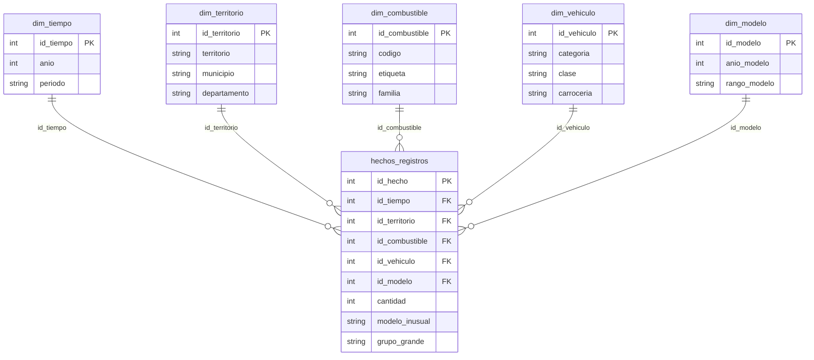

# Etapa 5 · Modelo multidimensional

**Proyecto:** Vehículos eléctricos e híbridos matriculados en Colombia (RUNT 2.0, datos.gov.co `ntxy-q9ix`)
**Equipo:** Angelica Olier, Johan Martinez

**Fuentes de las cifras:** `data/powerbi/` (`hechos_vehiculos.csv`, `dim_territorio.csv`, `dim_combustible.csv`,
`dim_anio.csv`, `LEEME.md`) y `data/processed/resultados_conocimiento_evidente.json`, generados por
`conocimiento_evidente.py`. Este documento no agrega datos nuevos. Las cifras salen de esos archivos o de sumar
valores publicados en ellos.

> **Alcance de este documento.** Aquí se describe el **diseño lógico** del modelo estrella de la Etapa 5. Los archivos
> que existen hoy en `data/powerbi/` son una versión anterior y más simple de ese modelo: tienen una tabla de hechos con
> llaves naturales (`territorio`, `combustible`, `anio_registro`) y tres dimensiones (`dim_territorio`,
> `dim_combustible` y `dim_anio`). Las llaves sustitutas (`id_*`), `dim_vehiculo`, `dim_modelo` y los atributos
> `familia`, `categoria`, `periodo` y `rango_modelo` todavía no existen en ningún archivo. Se construyen a partir de las
> columnas de `hechos_vehiculos.csv` siguiendo las reglas de este documento.

---

## 1. Datos usados

| Concepto | Valor | Fuente |
|---|---:|---|
| Grupos de registro (filas de hechos) | 6.772 | `hechos_vehiculos.csv`; `preparacion.registros_analisis` |
| Vehículos registrados (`SUM(cantidad)`) | 155.777 | `hechos_vehiculos.csv`; `preparacion.vehiculos` |
| Periodo | 2015–2024 | `meta.periodo` |
| Territorios distintos | 247 | `p2_territorial.indicadores.territorios_con_registros` |
| Departamentos | 32 | `p2_territorial.indicadores.departamentos_con_registros` |
| Excluidos por ventana (2025–2026) | 3.976 grupos · 177.124 vehículos | `meta.fuera_de_la_ventana` |
| Filas eliminadas por calidad | 0 | `preparacion.filas_eliminadas_por_calidad` |

### Unidad de análisis y granularidad

Estos dos conceptos son distintos y no se deben confundir.

- **Unidad de análisis:** el **vehículo matriculado en un año de registro**. Las preguntas se responden en vehículos,
  así que los vehículos se cuentan con `SUM(cantidad)` y no contando filas. No son vehículos únicos ni parque activo:
  la fuente no trae placa ni identificador, de modo que un vehículo que cambie de registro no se puede seguir.
- **Granularidad de la tabla de hechos:** **una fila por combinación única de combustible, clase, carrocería, año
  de registro, año del modelo y territorio**. Cada fila es un *grupo* de vehículos y `cantidad` dice cuántos vehículos
  tiene. En los datos hay 6.772 combinaciones distintas de esas seis variables y 6.772 filas, así que ninguna
  combinación está repetida.

Por lo tanto `COUNT(*)` cuenta grupos (6.772) y `SUM(cantidad)` cuenta vehículos (155.777). Las dos cifras responden
preguntas diferentes.

---

## 2. Preguntas de negocio

| # | Pregunta | Dimensiones | Medidas principales |
|---|---|---|---|
| **P1** | ¿Cuál es la tendencia de crecimiento de los vehículos eléctricos registrados entre 2015 y 2024, y qué tipos de vehículo la impulsan? | `dim_tiempo`, `dim_combustible` (familia = Eléctrico), `dim_vehiculo` | Vehículos registrados, Participación % |
| **P2** | ¿El crecimiento anual de los eléctricos es homogéneo entre territorios? | `dim_tiempo`, `dim_territorio`, `dim_combustible` | Vehículos registrados por año y territorio, Territorios distintos, Participación % |
| **P3** | ¿Cómo cambia la distribución de los vehículos registrados por clase y año del modelo a lo largo del tiempo? | `dim_tiempo`, `dim_vehiculo`, `dim_modelo` | Vehículos registrados, Participación % (denominador: el año de registro) |
| **P4** | ¿Qué diferencias muestran el promedio, la mediana y la concentración por combustible, tipo de vehículo y territorio? | `dim_combustible`, `dim_vehiculo`, `dim_territorio` | Promedio y Mediana de vehículos por territorio, Participación %, Grupos de registro |

En P2 el crecimiento anual se obtiene comparando *Vehículos registrados* de un año con el año anterior dentro de cada
territorio. Esa variación también se recalcula y no se suma (ver sección 5).

---

## 3. Modelo estrella

Todas las relaciones son **muchos a uno** y filtran en **un solo sentido**, de la dimensión hacia los hechos.

### 3.1 `hechos_registros`

Hay una fila por grupo de registro (6.772 filas).

| Campo | Tipo | Descripción |
|---|---|---|
| `id_hecho` (PK) | entero | Llave sustituta del grupo. |
| `id_tiempo`, `id_territorio`, `id_combustible`, `id_vehiculo`, `id_modelo` (FK) | entero | Llaves hacia cada dimensión. |
| `cantidad` | entero | Vehículos del grupo. Es la única medida aditiva de base. |
| `modelo_inusual` | Sí/No | Sí cuando el año del modelo es mayor que el año de registro + 1. Hay 34 grupos y 173 vehículos marcados (`preparacion.marcas`). Se marca y no se corrige. |
| `grupo_grande` | Sí/No | Sí cuando `cantidad` > 16 (umbral IQR de la Etapa 2). Son 942 grupos con 137.628 vehículos, el 88,35 % del total. Son datos reales y no se eliminan. |

Las dos marcas son atributos del grupo y no medidas. Sirven para filtrar o segmentar.

### 3.2 `dim_tiempo`

| Campo | Regla |
|---|---|
| `id_tiempo` (PK) | Llave sustituta. |
| `anio` | Año de registro, 2015–2024 (10 filas, igual que `dim_anio.csv`). |
| `periodo` | `2015-2019` si `anio` ≤ 2019; `2020-2024` en otro caso. |

Por periodo, según `hechos_vehiculos.csv`: 2015-2019 tiene 1.169 grupos y 9.079 vehículos; 2020-2024 tiene 5.603 grupos y 146.698 vehículos.

### 3.3 `dim_territorio`

| Campo | Regla |
|---|---|
| `id_territorio` (PK) | Llave sustituta. |
| `territorio` | Llave natural «MUNICIPIO (DEPARTAMENTO)». Hay 247 valores. |
| `municipio` | Nombre canónico del municipio. Hay 244 nombres distintos. |
| `departamento` | Nombre canónico del departamento. Hay 32. |

La llave tiene que ser `territorio` y no `municipio`, porque 3 nombres de municipio existen en más de un departamento
(`LEEME.md`, regla 2). BOGOTA D.C. y CUNDINAMARCA son territorios distintos en la fuente.

### 3.4 `dim_combustible`

Tiene 4 filas. `codigo` y `etiqueta` salen de `dim_combustible.csv`. Las cifras salen de `p1_composicion.por_combustible`.

| `codigo` | `etiqueta` | `familia` | Grupos | Vehículos |
|---|---|---|---:|---:|
| ELECTRICO | Eléctrico (BEV) | Eléctrico | 3.583 | 36.969 |
| GASO ELEC | Híbrido gasolina-eléctrico (HEV/PHEV) | Híbrido | 2.911 | 117.315 |
| DIES ELEC | Híbrido diésel-eléctrico | Híbrido | 274 | 1.489 |
| HIDROGENO | Hidrógeno | Otro | 4 | 4 |

Por familia: Eléctrico tiene 36.969 vehículos, Híbrido 118.804 y Otro 4. La fuente no distingue HEV de PHEV.

### 3.5 `dim_vehiculo`

Hay una fila por combinación de clase y carrocería presente en los hechos, 68 en total. Cada clase pertenece a una
sola categoría. Las cifras por clase salen de `p1_composicion.por_clase`.

| `categoria` | Clases | Vehículos |
|---|---|---:|
| Liviano | AUTOMOVIL (36.171), CAMIONETA (90.709), CAMPERO (8.435) | 135.315 |
| Pasajeros | BUS (1.750), BUSETA (2), MICROBUS (10) | 1.762 |
| Carga | CAMION (718), TRACTOCAMION (4), VOLQUETA (2) | 724 |
| Motorizado ligero | CICLOMOTOR (14.441), MOTOCICLETA (1.159), MOTOCARRO (674), TRICIMOTO (275), MOTOTRICICLO (15), CUADRICICLO (1.410), CUATRIMOTO (2) | 17.976 |
| **Total** | 16 clases | **155.777** |

Las 16 clases del dataset quedan asignadas y ninguna clase queda sin categoría. La carrocería tiene 45 valores
distintos, entre ellos «SIN CARROCERIA» y «SIN DATO» (sección 6).

### 3.6 `dim_modelo`

Hay una fila por año del modelo. Son 25 valores, de 1997 a 2026.

| `rango_modelo` | Regla | Grupos | Vehículos |
|---|---|---:|---:|
| Hasta 2017 | `anio_modelo` ≤ 2017 | 411 | 1.818 |
| 2018-2019 | 2018–2019 | 836 | 5.547 |
| 2020-2021 | 2020–2021 | 1.552 | 19.493 |
| 2022-2023 | 2022–2023 | 2.462 | 62.701 |
| 2024 o posterior | `anio_modelo` ≥ 2024 | 1.511 | 66.218 |

El año del modelo **no es** el año de registro. Un vehículo registrado en 2024 puede tener modelo 2025 o 2026, y eso
es normal. Las series de tiempo usan siempre `dim_tiempo`.

---

## 4. Jerarquías

| Dimensión | Jerarquía (nivel superior → inferior) | Nota |
|---|---|---|
| `dim_tiempo` | `periodo` → `anio` | 2 periodos de 5 años; no hay mes (la fuente no lo trae). |
| `dim_territorio` | `departamento` → `municipio` | En el nivel inferior se usa `territorio` como llave para no fusionar municipios homónimos. |
| `dim_combustible` | `familia` → `combustible` (`codigo`/`etiqueta`) | Familia Híbrido = GASO ELEC + DIES ELEC. |
| `dim_vehiculo` | `categoria` → `clase` → `carroceria` | Una carrocería puede aparecer en varias clases. El miembro hoja es la pareja clase-carrocería. |
| `dim_modelo` | `rango_modelo` → `anio_modelo` | Rangos cerrados de 2 años, salvo los extremos. |

Al subir o bajar en cualquiera de estas jerarquías, *Vehículos registrados* y *Grupos de registro* se suman sin
problema. Las demás medidas se recalculan en cada nivel (sección 5).

---

## 5. Medidas

| Medida | Significado | Unidad | Fórmula | Agregación | ¿Se puede sumar? |
|---|---|---|---|---|---|
| **Vehículos registrados** | Vehículos matriculados en el contexto filtrado. | vehículos | `SUM(cantidad)` | Suma | **Sí**, en todas las dimensiones. |
| **Grupos de registro** | Filas de hechos (combinaciones únicas) en el contexto. | grupos | `COUNT(*)` | Conteo | **Sí**, en todas las dimensiones (cada fila pertenece a un solo miembro de cada dimensión). |
| **Territorios distintos** | Territorios con al menos un registro en el contexto. | territorios | `COUNT(DISTINCT id_territorio)` | Conteo distinto | **No.** Un territorio aparece en varios años, combustibles y clases. Sumar los subtotales lo cuenta varias veces. |
| **Participación %** | Peso de un grupo dentro de un denominador declarado. | % | vehículos del grupo / vehículos del denominador × 100 | Razón | **No.** Solo suman 100 % las partes de un mismo denominador. Entre denominadores distintos no se suman ni se promedian. |
| **Promedio de vehículos por territorio** | Vehículos medios por territorio con registros. | vehículos/territorio | `SUM(cantidad) / COUNT(DISTINCT id_territorio)` | Razón | **No.** Se recalcula como cociente de dos totales. No es el promedio de los promedios. |
| **Mediana de vehículos por territorio** | Valor central de los totales por territorio. | vehículos/territorio | 1) total por territorio = `SUM(cantidad)` agrupado por `id_territorio`; 2) mediana de esos totales | Estadístico de orden | **No.** No se suma ni se promedia. Se recalcula siempre desde los totales por territorio. |

### Cómo se recalculan las medidas no aditivas

- **Territorios distintos.** Se evalúa de nuevo `COUNT(DISTINCT id_territorio)` en cada celda y en cada total. Por
  eso un total puede ser menor que la suma de sus filas. El total general es 247.
- **Participación %.** Siempre se declara el denominador. El total general es 155.777. En perfiles por combustible,
  departamento o año, el denominador son los vehículos de ese combustible, departamento o año (`LEEME.md`, regla 4).
  En P3, la distribución anual usa como denominador los vehículos del año de registro, y así cada año suma 100 %.
  En DAX el denominador se fija con `CALCULATE([Vehículos registrados], ALL(...))` o `ALLEXCEPT(...)` sobre la
  dimensión que corresponda.
- **Promedio por territorio.** Se recalcula `[Vehículos registrados] / [Territorios distintos]` en el contexto
  actual. El denominador incluye solo los territorios con registros en ese contexto, así que los territorios sin
  registros no cuentan como cero.
- **Mediana por territorio.** Primero se suma `cantidad` por territorio dentro del contexto y después se toma la
  mediana de esos totales. Por ejemplo: `MEDIANX(VALUES(dim_territorio[id_territorio]), [Vehículos registrados])`.
  No se debe calcular sobre `cantidad` fila a fila, porque eso daría la mediana del tamaño de grupo, que es otra
  medida. Como la distribución es muy asimétrica (pocos grupos grandes concentran la mayoría de vehículos), la
  mediana y el promedio pueden ser muy diferentes. Por eso P4 los compara.
- **Variación anual (P2).** Se calcula como (vehículos del año − vehículos del año anterior) / vehículos del año
  anterior × 100, a partir de *Vehículos registrados*. Es una razón y se recalcula en cada nivel.

### Valores de control

Estos valores salen de `LEEME.md` y del JSON y sirven para validar las medidas:

| Medida | Filtro | Valor |
|---|---|---:|
| Vehículos registrados | sin filtros | 155.777 |
| Grupos de registro | sin filtros | 6.772 |
| Territorios distintos | sin filtros | 247 |
| Vehículos registrados | familia = Eléctrico | 36.969 |
| Participación % eléctricos | denominador: total | 23,73 % |
| Vehículos registrados | año = 2024 | 53.934 |
| Vehículos registrados | `grupo_grande` = Sí | 137.628 |
| Grupos de registro | `modelo_inusual` = Sí | 34 |

---

## 6. Valores faltantes y categorías desconocidas

Ninguna columna de `hechos_vehiculos.csv` tiene celdas vacías. El único faltante de origen ya se trató en la Etapa 2.

| Valor | Qué significa | Dónde | Tratamiento |
|---|---|---|---|
| **«SIN DATO»** | **Faltante:** la fuente no informó la carrocería. | `carroceria`: 1 grupo de 2 vehículos (tricimoto eléctrica, registro 2020, modelo 2019, FUNZA (CUNDINAMARCA)). | En la Etapa 2 el nulo se reemplazó por la categoría explícita «SIN DATO» (`calidad_etapa2.py`, `conocimiento_evidente.py`). **Se conserva como miembro propio de `dim_vehiculo`.** No se imputa, porque inventar una carrocería agregaría información falsa. |
| **«SIN CARROCERIA»** | **No aplicable:** el vehículo no tiene carrocería en el sentido de la clasificación. | `carroceria`: 2.117 grupos y 17.260 vehículos. Son casi todos motorizados ligeros (CICLOMOTOR, MOTOCICLETA, CUADRICICLO, TRICIMOTO, MOTOTRICICLO, CUATRIMOTO). | **Es una categoría real y no un faltante.** No se mezcla con «SIN DATO». |

Reglas del modelo:

1. «SIN DATO» y «SIN CARROCERIA» son **miembros distintos** de `dim_vehiculo` y se muestran por separado en visuales y
   filtros.
2. Ningún valor faltante o desconocido se elimina ni se convierte en BLANK. Si se eliminara, *Vehículos registrados*
   dejaría de sumar 155.777.
3. Si una carga futura trae otros nulos en atributos de dimensión, se aplica la misma regla: categoría explícita
   «SIN DATO» en lugar de imputar. Si trae una llave sin pareja en su dimensión, se crea un miembro «SIN DATO» en esa
   dimensión y la fila no se descarta.
4. Caso para revisar: hay 1 grupo de clase CAMIONETA con carrocería «SIN CARROCERIA» (1 vehículo, ELECTRICO, 2024,
   ENVIGADO (ANTIOQUIA)). Para una camioneta, «no aplicable» es poco esperable. Se conserva tal como viene en la
   fuente y se documenta, sin corregirlo.
5. Las brechas propias de la fuente no son valores faltantes del modelo y no se rellenan: no hay mes, no se distingue
   HEV de PHEV, no hay placa y no hay población ni puntos de carga.
